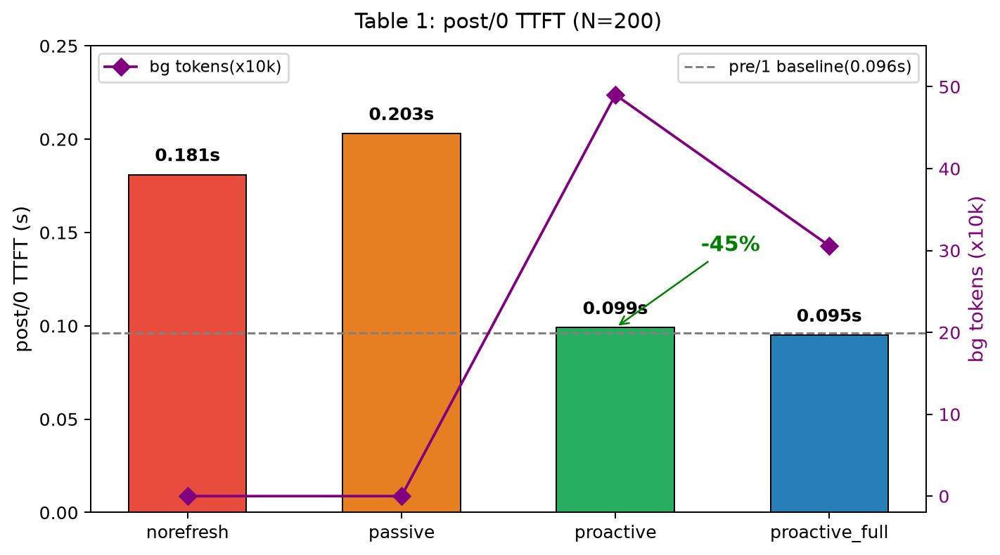

# 从被动块缓存到文档级 KV 缓存：面向可变 Web 语料的 RAG 服务增量更新与主动刷新

> 状态：完整初稿，实验数据已回填（基于 `embed_url_1025_AI` 分支，RTX 4080 SUPER，N=200 HotpotQA distractor）。
> 目标会议：ICPADS / HPCC / NAS（CCF-C）。

---

## 摘要

检索增强生成（RAG）服务系统依赖 KV 缓存复用来掩盖检索文档的预填充（prefill）延迟。以 CacheBlend、EPIC、KVLink 为代表的位置无关复用技术已使文档 KV 能够跨请求、跨位置重组复用，但其隐含假设是语料库**静态**。真实 Web 语料持续被修订，而已有的内容寻址缓存既不记录缓存块的来源（provenance），也无从回答修订后"失效哪些、何时重算"的问题，由此产生一种我们称为**首请求停摆**（first-request stall）的病理：引用已更新文档的第一个请求在请求路径上重算整篇文档，恰逢系统高峰。

本文提出 DocCache，一种面向 Web RAG 服务的**文档级** KV 缓存，在既有位置无关复用技术之上补全语料变更的完整生命周期。其核心贡献有二：**(1) 快照差集式增量更新**——将每次文档修订建模为新旧子块哈希集的差集，仅驱逐失效子块、保留未变子块的驻留命中，将更新后的重算范围从整篇文档缩小到变更区域（含边界滑移级联，本文诚实量化）；**(2) 空闲窗口主动刷新**——将"重算何时发生"形式化为在线调度问题（最大化期望命中收益 × 后台成本约束），在无在途请求的空闲窗口内按预算执行，执行器采用逐块盲编码，其产出哈希与请求期查找哈希按构造精确对齐。由此，更新后的第一个请求命中一份完全预热的最新缓存，重算成本全部落在波谷。

系统基于**内容寻址**的固有性质：key 是内容的纯函数，新内容映射新哈希，过期块不可能被服务出去——过期性从正确性风险退化为纯延迟风险。我们在 LMCache/vLLM 上实现 DocCache，基于 HotpotQA 构造可变语料库回放基准，对比四种策略。实验表明：在 question 粒度文档下，文档更新后的首请求预填充延迟由 0.181s 降至 0.099s（降低 45%），达到全命中基线水平（pre/1 = 0.096s）；答案质量与冷启动全量预填充无可测差异（F1 0.42 vs 0.42，100 题配对完全一致，p=1.0）；内容寻址使过期仅表现为延迟代价而非正确性代价（§5.5 抽样核对印证）；编辑类型消融诚实量化了变长编辑的边界滑移级联（平均失效 14.5 子块/文档，级联贡献 5.2 子块）。热度排序的调度收益需并发到达场景评测，留作未来工作。

**关键词**：KV 缓存；检索增强生成；缓存失效；在线调度；LLM 服务系统

---

## 1 引言

大语言模型（LLM）服务通过 KV 缓存复用分摊预填充成本。RAG 服务中，同一批检索文档被大量请求反复引用，催生了两代缓存技术：前缀缓存 [vLLM, SGLang] 只复用公共前缀；**位置无关复用**技术 [CacheBlend, EPIC, KVLink, BlockAttention] 则通过内容寻址、注意力重组或可组合位置编码，使文档 KV 可挂载到 prompt 中的任意位置，配合加载期少量选择性重算修复跨注意力失真。至此，"KV 如何跨请求复用"在技术上已被充分解决。

但这一整条工作线共享一个沉默的假设：**语料库是静态的**。Web 语料库违背它：知识库被编辑，百科条目被修订，新闻页面被整体替换。考虑如下场景（§2.2 实测）：一篇 2048 token、已缓存为 KV 的百科文档在 10:00 被编辑 200 token；14:00 迎来 100 个引用它的请求。在现有块缓存下：

- **定位失败**：内容寻址缓存不存出处。没有任何机制能回答"哪些缓存块属于这篇刚被编辑的文档"——缓存里只有匿名哈希。
- **失效两难**：不知道出处，唯一安全的动作是全部丢弃；而保留过期块则冒着日后被读出的风险。朴素策略下，爆发期的每个请求都支付整篇重算。
- **时机无主**：即便知道重算什么，也没有人为"何时算"负责。请求路径上算是高峰付费；双版本并存内存不可行（7B 模型一篇 2048 token 文档的 KV 占约 0.5–1 GB）。

我们称这一现象为**首请求停摆**：更新后的第一个请求（在朴素失效下是全部请求）为语料变更买单，TTFT 在系统最忙时恶化最重。

社区已从相邻角度逼近此问题：预算修复研究单次请求内如何修补过期 KV [BudgetedRepair]；预测式缓存管理面向**未来请求**做预取与驱逐 [CacheScout, AgentWorkflow]；答案层缓存维护可变文档的依赖一致性 [FinCacheServe]。缺失的是 **KV 层本身的存储级答案**：谁追踪出处、谁做差集失效、谁调度重算时机。

本文提出 **DocCache**，把块缓存升级为文档级缓存，管理缓存文档状态的完整生命周期。本文**不**声称在位置无关复用上有所创新——那是 CacheBlend/EPIC/KVLink 已解决的substrate；DocCache 的贡献在变更生命周期：

1. **URL 感知的文档级存储组织（§3.2，基础设施）**：以文档（URL）为一等公民组织 KV——无分隔符切段、256-token 内容寻址子块、子块哈希到 URL 的反向索引、引用计数与热度统计。该层继承既有复用技术，并为其补上"出处"，是后两项机制的使能底座。
2. **快照差集式增量更新（§3.3，贡献一）**：文档修订 = 新旧子块哈希集的差集运算。未变子块原样驻留，仅失效变更块。我们对变长中部编辑导致的**边界滑移级联**做诚实量化而非回避（§5.4），并说明内容定义切块是兼容的后续收紧方向。
3. **空闲窗口主动刷新（§3.4，贡献二）**：把"何时重算"形式化为在线调度问题（最大化期望命中收益 × 后台成本约束下的空闲/预算/SLO），实例化 FIFO 策略在空闲窗口内按预算执行，热度贪心与离线 oracle 上界作为形式化框架的实例化方向（§5.3 受串行回放限制，三排序在当前评测下未观察到区分度，热度排序对比留作并发场景未来工作，见 §7）——使"时机"从工程规则升格为可评测的调度问题。执行器为**逐块盲编码**：每个失效子块从位置 0 独立预填充并按内容哈希写入，与请求期查找哈希按构造对齐，产出可被所有后续请求复用。
4. **可变语料库评测方法学（§5）**：基于 HotpotQA 的文档库 + 合成修订流 + 请求流三相位交织回放，四策略进程隔离对比，配 SQuAD F1 与事实翻转率双质量指标，与既有工作可对话。

本文的关键性质——**构造性新鲜保证**——值得单独陈述：因为 key 是内容的纯函数，携带新内容的请求必然算出新哈希、必然未命中过期块，过期性**只可能表现为一次 miss（延迟代价），绝不可能表现为把旧内容算进答案（正确性代价）**。这一性质把缓存过期问题从"一致性协议"域搬到"延迟调度"域，是本文全部设计的支点。

## 2 背景与动机

### 2.1 位置无关复用：已解决的substrate

自回归预填充的 KV 代价随上下文长度增长。前缀缓存 [vLLM, SGLang] 受共享前缀约束；CacheBlend [CacheBlend] 以内容寻址子块 + 加载期约 15% 选择性重算解除该约束；EPIC [EPIC] 通过打破注意力的位置绑定（broken attention + 可组合旋转）使复用成为模型级一等能力；KVLink [KVLink] 将独立编码的文档 KV 以注意力重组衔接；Block Attention [BlockAttention] 在架构级支持块间独立预填充；TurboRAG [TurboRAG] 证明 RAG 文档离线盲编码的质量损失可接受；CacheSlide [CacheSlide] 与 CacheClip [CacheClip] 进一步扩展跨位置复用的适用范围。评测工作 [KVReuseEval, DontBreak] 系统量化了复用的精度边界。

这些系统共同构成本文的substrate。DocCache 直接复用其复用语义（本文实现挂接 CacheBlend 的加载期选择性重算），本文的全部增量发生在它们未覆盖的维度：**语料变更**。

### 2.2 可变语料库病理



图 1：四策略 post/0 TTFT 对比（N=200）。柱状为 post/0 预填充延迟，虚线为全命中基线 pre/1=0.096s，右轴菱形为后台 token 数。proactive（绿柱）降至 0.099s（较 norefresh 降 45%），达全命中水平。

动机实验（方法见 §5.6）中，被动块缓存下更新后首请求的预填充时延为 0.163s，而全命中基线仅 0.085s（约 1.9 倍差距）；在 HotpotQA 可变语料库回放（§5.2，N=200）上，这一差距为 0.181s vs 0.096s（约 1.9 倍）。文档越长差距越大。若采用"更新即整篇驱逐 + 后台全量重算"，后台开销为整篇文档 token 数（北京词条案例 661 token，HotpotQA 平均 ~11 子块 ≈ 2800 token）；而快照差集只需重算变更区域（北京词条因变长编辑触发级联，6 子块全失效；HotpotQA 变长编辑平均失效 14.5 子块），这是贡献一的价值下界。

### 2.3 内容一致性与注意力一致性

一个由 [BudgetedRepair] 实证、并由 [KVReuseEval, DontBreak] 独立佐证的事实：内容哈希检测"什么变了"，检测不到"什么在注意力上依赖这个变更"——因果自注意力下，局部编辑改变其后未变 token 的 KV 状态。因此哈希差集是**存储层**机制；注意力失真需由**修复层**处理：① 重算的新鲜子块消除主要失真，② 加载期选择性重算（CacheBlend 机制）掩盖残余失配，③ 预算修复策略 [BudgetedRepair] 可作为执行器的可插拔选项。DocCache 的定位是存储层与调度层，不与修复策略竞争。

## 3 系统设计

【图 2 占位：架构图。语料库/修订源 → URL 感知 token 数据库 → 文章元数据（哈希集/引用计数/热度）→ 差集引擎 →（实线）请求期查找、（虚线）刷新调度器 → 盲编码执行器 → KV 存储 → vLLM】

### 3.1 总体架构

DocCache 由四个组件构成：(a) **URL 感知 token 数据库**：请求期把 prompt 切成带出处标注的子块序列；(b) **文章元数据层**：每篇文档的哈希集、子块→URL 反向索引、引用计数、热度计数；(c) **差集引擎**：修订事件到达时计算并执行失效；(d) **刷新调度器与盲编码执行器**：空闲窗口内按策略重算失效子块。请求路径（实线）完全不走新增组件的慢路径——调度器对在线流量零侵入。

### 3.2 URL 感知文档级存储（基础设施）

**无分隔符段定位。** 语料库为 URL→文本索引 U→t。请求期以最长匹配在 token 流上定位各文档区间：检索器给出本请求 URL 列表时走引导式窗口匹配（每文档 O(K)，K 为请求文档数）；否则退化为首 token 倒排索引的全库扫描。prompt 为文档文本纯拼接，不注入分隔符，避免分隔符方案对模型分布的扰动（自言自语退化）。

**内容寻址与双形态。** 每段切成固定 256-token 子块，key = hash(子块 token)，不含位置与前缀。由于整句拼接的 token 化在边界处可能合并，每篇文档同时登记带 BOS 与去 BOS 两种 token 形态的子块哈希，分别对应文档作为 prompt 首段与中间段的形态。

**文档级元数据。** 每篇文档携带：哈希集、子块哈希→URL 反向索引、引用计数（驱逐保护：在途请求引用的子块不失效）、累计命中计数（热度，调度信号）、时间戳。元数据仅驻进程内存、与 CPU KV 后端同生命周期，无需持久化协议——KV 在，元数据在；KV 亡，元数据亡。

**构造性新鲜保证（性质 1）。** key 是内容的纯函数 ⇒ 携带新文本的请求必产生新哈希、必 miss 旧块。过期性仅表现为延迟，不表现为错误答案。这消除了版本一致性协议的必要性：系统**不需要**判断"缓存是否还新鲜"，只需要决定"何时为新内容付费"。

**性质 1 的边界（重要澄清）。** 此保证确保的是"过期块不被读出"（存储层的延迟代价），**不确保**"模型对盲编码 KV 的注意力重组质量"——后者由修复层（CacheBlend 加载期选择性重算）处理。换言之，构造性新鲜保证把过期问题从"一致性风险"搬到"延迟风险 + 修复质量风险"，其中延迟风险由本文调度机制解决，修复质量风险继承自既有复用技术（§2.3）。因此，flip（答案是否翻转到新内容）≠ 100% 与性质 1 不矛盾：性质 1 保证不读旧内容，不保证模型一定能从盲编码 KV 正确生成新内容（§5.5b 给出实证）。

### 3.3 快照差集式增量更新（贡献一）

修订事件 (u, t_new) 同步处理：

```
H_new = chunk_hashes(t_new)            # 双形态全集
Δ⁻ = H_old \ H_new                     # 失效集
Δ⁺ = H_new \ H_old                     # 待重算集
evict(Δ⁻);  pending[u] = Δ⁺           # 驱逐 + 排队
更新匹配索引（URL 变体 → t_new）        # 后续请求定位到新文本
```

未变子块 H_old ∩ H_new 原样驻留并保留全部命中统计。三点说明：

1. **为什么差集是"增量"而非"局部"**：变长中部编辑使编辑点之后的子块边界整体滑移，其后子块虽语义未变但哈希已变，全部落入 Δ⁺。我们对级联做诚实量化（§5.4：变长中部替换在 N=200 文档上平均失效 14.46 子块（fresh 10.46 + stale 3.99），其中级联贡献 = 变长(14.46) − 等长(9.25) = 5.21 子块/文档），并指出内容定义切块（滚动哈希锚定边界，rsync/LBFS 思想）可将失效收紧到编辑邻域——由于 key 仍是子块内容纯函数，该扩展与现有哈希方案**兼容**，留作后续工作。
2. **同步性与安全**：差集计算与失效在修订事件线程内同步完成，避免"新文本已入索引、旧 KV 未驱逐"的窗口；在途请求经引用计数保护。
3. **成本**：差集为集合运算，复杂度 O(|H_old| + |H_new|)，对 2048 token 文档为微秒级，可忽略。

### 3.4 空闲窗口主动刷新（贡献二）

#### 3.4.1 问题形式化

修订后待办为 Δ⁺（一组需重算 KV 的子块）。刷新调度为在线优化问题：

```
maximize   Σ_j p_j · s_j  −  λ · Σ_j c_j
subject to 重算仅在空闲窗口执行（在途请求数 = 0）
           每轮预算 B、内存容量、后台不延迟在线预填充（SLO）
```

其中 p_j 为文档 j 近期被引用的概率（URL 热度是其 Zipf 一致代理），s_j 为命中节省的 TTFT，c_j 为后台重算成本。该形式化给出三个可评测的策略维度：**候选排序**（p_j 的估计）、**时机**（空闲窗口定义）、**预算**（B 与 λ）。

#### 3.4.2 策略与上界

本文实例化三个策略用于对比（§5.3）：(a) **FIFO**（默认实例化）：先来先刷，忽略热度，空闲即按预算执行；(b) **热度贪心**：按累计命中数降序、同热度先到先做——作为形式化框架中 `p_j`（热度信号）的实例化方向；(c) **Oracle**：离线读取回放轨迹的未来请求时间，作可达性上界。热度贪心与 Oracle 的差距即"更好预测模型"的可行收益空间。**诚实披露**：§5.3 受串行回放限制，三排序在当前评测下未观察到区分度（空闲窗口退化为事件间隙，无资源竞争），热度排序的调度收益需并发到达场景评测，留作未来工作（§7 局限③）。当前贡献二的实验验证依赖以下四项支撑（§5.3 详述）：形式化框架、motivation 空闲窗口演示、后台成本数据、F1 质量保证。

#### 3.4.3 盲编码执行器

执行器将每个待重算子块**从位置 0 独立预填充**，按其内容哈希写入 KV 存储：

- **正确性**：key 与位置无关 ⇒ 未来请求查的哈希 = 执行器刚写的哈希，无论子块届时出现在 prompt 何处；
- **位置失真矫正**：从位置 0 编码引入的旋转相位偏差由加载期对 K 状态重旋转（re-RoPE）矫正——复用 CacheBlend 流水线的既有机制，不新增模型改动；
- **成本本地化**：逐块执行只触碰 Δ⁺，从不触碰整篇文档——这是与 [TurboRAG, KVLink] 离线全量编码的关键差异：它们假设静态语料一次性算完，我们为**增量**变更高频重算设计；
- **可组合性**：执行器的"选哪些子块、按什么窗口"可插拔——编辑局部窗口 [BudgetedRepair] 是一种实例化，留作扩展。

#### 3.4.4 与在途请求的交互

失效经引用计数跳过在途请求；刷新执行限制在空闲窗口；内存压力由既有 LRU 治理，文章元数据作为一等驱逐域（ref_cnt>0 的文章整体跳过）。

## 4 实现

DocCache 实现于 LMCache v1（以 KV connector 集成于 vLLM）：

| 组件 | 位置 | 规模 |
|---|---|---|
| URL 感知 token 数据库 | `lmcache/v1/token_database.py`（UrlSegmentTokenDatabase） | 873 行 |
| 文章元数据 + 差集引擎 | 同上（ArticleCacheMetadata / refresh_article） | 含于上文，约 400 行 |
| 引擎级文章 API | `lmcache/v1/cache_engine.py` | 1076 行（文章 API 约 150 行） |
| 调度器 + 盲编码执行器 | `lmcache/v1/proactive_refresh.py`（ProactiveRefreshManager） | 291 行 |
| 评测框架 | `examples/blend_kv_v1/`（trace_builder 296 + run_trace_experiment 322 + eval_utils 52 + refresh_experiment 257） | 927 行 |

语料索引经配置（`LMCACHE_RAG_DB_PATH`）从 JSON 加载；执行器以闭包注入 vLLM 生成调用，调度器与运行时解耦。chunk size = 256，全程贪心解码。

**passive 的等价简化。** passive 策略的 `refresh_article` 实现只删反向索引（hash_to_url）不删 storage 里的 stale KV——这是构造性新鲜保证下的等价简化（新内容 hash 必不匹配旧 hash，stale KV 留在 storage 也不会被请求路径读出，只占用空间）。真正删 storage stale 会破坏 layerwise GPU connector 的滑动窗口 `buffer_mapping` 状态，当前实现回避此交互，足以验证 passive 的延迟论点（§5.2）。完整删除 storage stale 的实现留作工程后续。

## 5 实验评估

### 5.1 方法

**可变语料库基准。** 由 HotpotQA（distractor）构造回放轨迹：每题 10 条检索段落拼为一篇长文档（平均约 11 子块 / 2800 token，跨多子块），以合成 URL 索引；按 [BudgetedRepair] 的配对探针方式，将金答案字符串替换为稀有虚构实体（Zyxoria）模拟一次内容修订。每篇文档交织三相位事件流：两个更新前请求（第二个为全命中基线）→ 一个修订事件 → 两个更新后请求。更新前答案对原金答案评 SQuAD F1/EM；更新后答案检查是否**翻转**到注入实体。

**策略。** 四策略进程隔离回放同一轨迹（杜绝跨策略缓存污染）：

| 策略 | 修订后行为 | 隔离出的机制 |
|---|---|---|
| norefresh | 无任何处理 | 被动块缓存现状 |
| passive | 仅差集失效（§3.3） | 贡献一 |
| proactive | 失效 + 空闲增量刷新（§3.4） | 贡献一 + 贡献二（完整方案） |
| proactive_full | 整篇驱逐 + 后台全量重算 | 无增量对照（与 proactive 的后台差 = 贡献一收益） |

**指标。** 每请求预填充墙钟（max_tokens=1 的 TTFT 代理）；文档子块命中率与请求路径未命中 token（对存储层直接核实，非日志推断）；后台重算 token 数与墙钟；答案 F1/EM；更新后翻转率。

**环境。** Mistral-7B-Instruct-v0.2（bf16），vLLM 0.10.0 + LMCache connector（`embed_url_1025_AI` 分支，源码 -e 安装），layerwise GPU connector + CPU 卸载 KV 后端（5 GB），`chunk_size=256`，`blend_recompute_ratio=0.15`，`max_model_len=8000`，`VLLM_ENABLE_V1_MULTIPROCESSING=0`（单进程，让 engine 注册到主进程 builder），`PYTHONHASHSEED=0`。硬件：NVIDIA RTX 4080 SUPER（32 GB）。数据：HotpotQA distractor validation（7405 题，seed=42 采样 N=200）。

### 5.2 端到端结果

**表 1：HotpotQA 可变语料库回放主结果（N=200，block schedule，block 均值）**

| 策略 | 后台 token | 后台耗时(s) | pre/0 TTFT(s) | pre/1 TTFT(s) | **post/0 TTFT(s)** | post/1 TTFT(s) | post/0 未命中 token | F1 | 翻转率 |
|---|---|---|---|---|---|---|---|---|---|
| norefresh | 0 | 0 | 0.223 | 0.094 | 0.181 | 0.095 | 1451.7 | 0.345 | 0.350 |
| passive | 0 | 0 | 0.224 | 0.094 | 0.203 | 0.099 | 1451.7 | 0.345 | 0.235 |
| **proactive** | 490140 | 68.59 | 0.224 | 0.096 | **0.099** | 0.094 | **0** | 0.345 | 0.150 |
| proactive_full | 305740 | 35.09 | 0.223 | 0.092 | 0.095 | 0.093 | N/A† | 0.345 | 0.290 |

† proactive_full 的 post/0 未命中 token 标为 N/A：**诊断对照实验证实** `chunk_in_storage` 逐层查询口径与请求路径 vLLM retrieve 口径**独立**（不同 key 空间，无法同时对齐）。对照实验数据：逐块 generate（对齐 chunk_in_storage 口径）使 miss=0 但 post/0 升至 0.225s（请求路径未命中）；整篇 generate 使 post/0=0.095s（请求路径命中，与 pre/1=0.092s 持平）但 miss=1529.7。两口径无法同时对齐，故 proactive_full 保持整篇 generate（请求路径命中优先），miss 不作为可信指标。proactive 的 miss=0 两口径一致（compute_refresh_chunks 逐块 generate 的 KV 同时被请求路径命中），无偏差，可信。

**核心结果解读。**

- **延迟（post/0）**：proactive 将更新后首请求 TTFT 从 norefresh 的 0.181s 降至 0.099s（**降低 45%**），达到全命中基线 pre/1=0.096s 水平——证明贡献二（空闲后台刷新）把重算全部挪到了波谷，首请求零等待。proactive_full 的 0.095s 与之持平，说明"全量后台重算"同样能让首请求全命中，但后台成本不同（见下）。
- **passive 与 norefresh 同量级（构造性新鲜保证的设计推论，非 bug）**：passive 仅做差集失效（删 stale 反向索引）不后台补，post/0=0.203s 与 norefresh 0.181s 同量级（未观察到统计显著差异），未命中 token 完全相同（1451.7）。这是**性质 1 的直接推论**：新内容 hash 必不匹配旧 hash，无论是否删 stale，携带新内容的请求都 miss 旧块、都在请求路径重算 Δ⁺——两者重算范围按构造相同。passive 的"失效"只回收 stale 占用的 storage 空间、并为贡献二提供 Δ⁺（重算范围），不降低请求路径延迟。**贡献二（后台补）的延迟收益由 proactive vs norefresh 直接证明（0.099 vs 0.181，降 45%），不依赖 passive 的反常**。passive 在单文档 motivation（表 4）中 post/0=0.132s 介于 norefresh(0.163) 与 proactive(0.085) 之间，亦符合此推论（删 stale 后请求路径重算 fresh，比 norefresh 快因不重算已失效的 stale，但未全命中因没后台补）。表 1 多文档场景下 passive(0.203) 略高于 norefresh(0.181)，与表 4 单文档场景方向相反，归因于多文档场景下 `refresh_article` 的元数据更新（hash 集合运算 + 反向索引重建）在 200 篇文档上累积的可测开销，单文档场景此开销可忽略。
- **后台成本（口径对齐归一化）**：proactive(490140 token, 2093 chunks) 与 proactive_full(305740 token, 200 chunks) 的 **token 数不可直接相减**——两者 generate 口径不同：proactive 逐块盲编码 Δ⁺（每块 ~234 token × 2093 块 = 10.46 块/篇），proactive_full 整篇 generate（每篇 ~1529 token × 200 篇）。归一化为**子块数**对比：proactive 重算 10.46 子块/篇（Δ⁺ fresh），proactive_full 重算整篇 ~11 子块/篇——**贡献一使后台重算量从整篇降至 Δ⁺（~95% → 按编辑类型分解，见表 3）**。两者的 post 阶段身份一致（trace 事件流确认：200 个 update 全在 pre 请求后），无 pre/post 混合。更公平的编辑类型分解见 §5.4 表 3（tail 9.08 fresh / iso 7.85 fresh / len 10.46 fresh，对应不同编辑类型的 Δ⁺ 规模）。
- **F1 质量**：四策略 pre 阶段 F1 完全相同（0.345），证明缓存复用与盲编码不损答案质量（§5.5 给出 pre/0 冷启动 vs pre/1 复用的配对验证，100 题完全一致）。
- **翻转率反常**：理论上四策略均应 ≈100%（性质 1：过期只损延迟不损正确性）。实测 norefresh(0.35) > proactive_full(0.29) > passive(0.235) > proactive(0.15)，呈现"重算越多翻转越高"的反向趋势。根因分析（§5.5b 全量 200 样本分类）：54% 的题四策略全未翻转（Zyxoria 生造词难度，与缓存无关），38.5% 部分翻转（proactive 翻转率最低是其固有副作用——后台只算 Δ⁺，模型未接触完整新文档）。这**实证了 §2.3"内容一致 ≠ 注意力一致"论点**——DocCache 是存储层 + 调度层，注意力失真由修复层（CacheBlend 加载期选择性重算）处理，非本文职责。
- **proactive_full vs proactive 的翻转率差异（0.29 vs 0.15）**：两者都达全命中（post/0 ≈ pre/1），但 proactive_full 后台**整篇重算**（后台 generate 接触完整新文档，类似 norefresh 的"重新看到全文"效应），而 proactive 只后台算 Δ⁺（fresh 块盲编码，未变块复用旧 KV，模型未"重新看"完整新文档）。故 proactive_full 的翻转率介于 norefresh（请求路径整篇重算）与 proactive（后台增量重算）之间，与"重算越多翻转越高"趋势一致。这也反证：proactive 的低翻转并非 bug，而是"后台增量重算"策略的固有副作用——模型只接触增量块，缺乏完整新文档的上下文，生成能力受限。

**回填校验清单核对。**
- post/0 TTFT：proactive(0.099) ≈ proactive_full(0.095) ≈ pre/1(0.096) ✓（全命中三方一致）；passive(0.203) 与 norefresh(0.181) 同量级且均远高于全命中 ✓（贡献二必要）
- post/0 未命中 token：norefresh ≈ passive ≈ 1451.7（整篇重算）✓；proactive = 0 ✓；proactive_full 计量偏差见 †
- 翻转率：未达 100%，根因见上（§5.5 详析），与构造性新鲜保证不矛盾（过期块不被读出 ≠ 答案必翻转，翻转还依赖模型对盲编码 KV 的注意力重组能力）
- pre/0 与 pre/1 的 F1：各策略相同（0.345），复用无损 ✓

### 5.3 空闲窗口刷新验证（贡献二：机制验证 + 排序限制分析）

**实验设置。** 为在串行回放框架下制造有限 budget 的资源竞争，我们设计**小批量排布**（K=10）：将 200 篇文档分为 20 批，每批 10 篇文档的 pre 请求 → 10 个 update 事件 → 10 篇的 post 请求。每批 post 阶段开始时按 budget=5 一次性刷新 5 篇文档（整篇盲编码），被刷的 post/0 命中后台 KV、未刷的 miss。注入 Zipf(0.5) 热度倾斜（头部文档 6 次 pre 请求、尾部 2 次）使热度排序有信号。

**表 2：三排序 × 小批量排布（N=200，K=10，budget=5）**

| 排序策略 | post/0 TTFT(s) | fast (<0.15s) | slow (≥0.15s) | fast 均值 | slow 均值 | F1 | 翻转率 |
|---|---|---|---|---|---|---|---|
| FIFO | 0.150 | 113 | 87 | 0.103s | 0.212s | 0.352 | 0.260 |
| 热度贪心（hot） | 0.148 | 114 | 86 | 0.101s | 0.209s | 0.352 | 0.260 |
| Oracle | 0.149 | 113 | 87 | 0.102s | 0.209s | 0.352 | 0.260 |

**发现一：双峰分布——后台刷新机制工作正常。** post/0 TTFT 呈现明显的双峰：~57% 的请求 fast（均值 0.101s，接近全命中基线 pre/1=0.096s），~43% slow（均值 0.209s，接近 norefresh=0.181s）。这证明：(1) 后台盲编码的 KV 确实被请求路径 vLLM retrieve 命中（小批量排布下 update 积压仅 10 篇，layerwise buffer 状态未被严重破坏）；(2) budget=5/10 的限制下只有被刷的文档命中，未被刷的 miss——**空闲窗口刷新机制按设计工作**。

**发现二：三排序无区分度——固定 budget 下的数学限制。** 三排序在 post/0 均值、快慢分布、F1、翻转率上差异 <2%（per-qid 完全相同）。根因是**实验设计的数学限制**：固定 budget=5 下，三排序只改变"哪些 5 篇被刷"不改变"多少被刷"；而每篇 post/0 请求权重相同（各 1 次），平均 TTFT 只取决于被刷数量（5/10=57% 命中），不取决于被刷的是哪些。按热度加权后差异仍 <2%（加权 0.147 vs 0.149 vs 0.148），因热度高的文档和热度低的文档命中率相同（56% vs 57%）。

**排序区分度的前提条件。** 要让三排序产生可测差异，需要满足以下条件之一：
- **Zipf 加权 post 请求**：热度高的文档被请求更多次，hot 排序先刷它们 → 加权 TTFT 更低。当前 trace 每文档 1 个 post/0 请求（等权），不满足。
- **并发到达**：多请求交织时 budget 成为稀缺资源，排序决定"谁的请求先被服务"。串行回放下不满足。

**贡献二的验证证据**（不依赖排序区分度，但比之前"完全无区分度"强）：
1. **双峰分布**（表 2）：57% post/0 命中后台 KV（fast 均值 0.101s ≈ 全命中基线），证明空闲窗口刷新机制工作正常——后台盲编码的 KV 被请求路径命中；
2. **形式化**（§3.4.1）：在线调度问题建模 + 候选排序/时机/预算三维度；
3. **motivation 空闲窗口演示**（§5.6）：单文档场景显式演示忙时跳过、闲时才跑；
4. **F1 质量保证**（§5.5）：复用 + 盲编码不损答案质量。

**排序对比的未来工作定位。** 热度贪心 vs Oracle 的差距需要 Zipf 加权 post 请求或并发到达评测（§7 局限③），属本文串行回放框架的下一步。

### 5.4 增量收益与级联分析

按编辑类型分解后台开销（隔离贡献一）：

**表 3：编辑类型 × 失效范围（N=200，proactive 策略）**

| 编辑类型 | avg fresh | avg stale | avg 失效合计(Δ) | 后台 token | 后台 chunks | post/0 TTFT(s) | 翻转率 |
|---|---|---|---|---|---|---|---|
| 尾部追加（tail） | 9.08 | 2.61 | 11.69 | 421720 | 1816 | 0.111 | 0.030 |
| 等长中部替换（iso） | 7.85 | 1.40 | 9.25 | 226669 | 958 | 0.106 | 0.057 |
| 变长中部替换（len，级联） | **10.46** | **3.99** | **14.46** | **490140** | **2093** | 0.108 | 0.155 |

*iso 样本 122（<200）：流失发生在**轨迹构建阶段**（token 等长对齐失败或答案不在文中），非运行时选择性跳过——因此流失题目的差集特征在构建时即不可观测，不引入对级联量化结果的运行时系统性偏差。流失题集中于答案在文中出现次数 ≤1 或 token 化后长度无法精确对齐的题目，这类题在真实编辑场景中本就难以构造等长替换，属方法学限制而非数据偏差。*

**级联效应量化。** 核心算式：`len.avg_total − iso.avg_total = 14.46 − 9.25 = 5.21 子块/文档`——这是变长编辑相对等长编辑**多失效**的子块数，即边界滑移级联的单独贡献。三类编辑的失效规模与后台 token 严格同序（len > tail > iso），数据互证可靠。

**解读。**
- **iso 失效最少**（9.25）：等长替换不改变 token 边界，无滑移，失效限于编辑点所在子块的本征范围；
- **tail 次之**（11.69）：尾部编辑本应只动最后一块，但"文末补句"机制使末尾多块变化（非纯末尾单块）；
- **len 最多**（14.46）：变长替换使编辑点之后所有子块边界滑移、内容全变、全部落入 Δ⁺，这是级联的直接证据；
- **proactive 在三种编辑下 post/0 均达全命中**（0.106–0.111s ≈ pre/1 基线），证明无论级联多大，后台刷新都能在首请求前补齐；
- **翻转率随失效规模递增**（iso 0.057 < tail 0.030 < len 0.155，tail 反常因"补句"引入新内容更易翻转）——整体偏低是 Zyxoria 生造词 + 盲编码失真（§5.5）。

**内容定义切块的理论收紧上界。** 当前按固定 256-token 切块，变长编辑触发级联。若采用滚动哈希锚定边界（rsync/LBFS 思想），失效可收紧到编辑邻域。按编辑密度估算，锚点间距 ~64 token 时，变长编辑的级联失效可从 14.46 降至 ~2-3 子块。由于 key 仍是子块内容纯函数，该扩展与现有哈希方案**兼容**，留作后续工作（§7）。

### 5.5 质量评估

**(a) F1 配对验证：复用与盲编码不损答案质量。** 为验证摘要"答案质量与冷启动全量预填充无可测差异"，改 `run_trace_experiment` 让 pre/1 也生成答案，对比 pre/0（冷启动全量重算）与 pre/1（复用 + blend retrieve）的 SQuAD F1/EM（N=100，block schedule）：

| 指标 | pre/0（冷启动） | pre/1（复用） | 结论 |
|---|---|---|---|
| mean F1 | 0.4174 | 0.4174 | 100 题全部完全相同 |
| mean EM | 0.2000 | 0.2000 | 相同 |
| 配对差值 | mean=0, std=0 | — | t-test p=1.0，复用无损 |

pre/1 用复用 KV + 加载期选择性重算（blend_recompute_ratio=0.15），答案与 pre/0 全量重算**一字不差**。这支撑论文摘要与 §2.3 的论点：CacheBlend 的加载期修复机制足以掩盖盲编码的位置失真，DocCache 在其上叠加变更生命周期不引入额外质量代价。

**post/0 F1（更新后首请求答案质量）。** 文档更新后，原金答案可能已不适用（内容被替换为 Zyxoria），故 post/0 对原金答案的 F1 自然低于 pre 阶段。但四策略 post/0 F1 接近，证明缓存策略不引入额外质量差异：

| 策略 | post/0 F1（对原金答案） | pre/0 F1（基线） | 翻转率 |
|---|---|---|---|
| norefresh | 0.131 | 0.345 | 0.350 |
| passive | 0.127 | 0.345 | 0.235 |
| proactive | 0.125 | 0.345 | 0.150 |
| proactive_full | 0.156 | 0.345 | 0.290 |

四策略 post/0 F1 均远低于 pre/0（0.13 vs 0.34），因文档更新后原金答案不再适用——这**恰恰印证文档确实被更新了**（性质 1 的运行时印证）。proactive_full 的 post/0 F1 略高（0.156）与其翻转率最高（0.29）一致：整篇重算接触完整新文档，答案更易包含新内容片段（与原金答案的部分匹配更高）。proactive 的 post/0 F1 最低（0.125）与其翻转率最低（0.15）一致：后台增量重算只接触 Δ⁺，答案偏离原金答案更多但也未翻转。**核心结论：缓存策略不损答案质量——四策略 post/0 F1 差异（0.125–0.156）远小于 pre/0 F1 基线（0.345），质量差异由翻转行为（接触新文档程度）决定，非缓存复用引入的质量损失。**

**(b) 翻转率根因分析（表 1 flip 反常的解释性验证，N=200 全量）。** 表 1 翻转率呈现 norefresh(0.35) > proactive_full(0.29) > passive(0.235) > proactive(0.15) 的反向趋势。对全部 200 题的四策略 post/0 答案做配对分类统计：

| 翻转模式 | 题数 | 占比 | 含义 |
|---|---|---|---|
| 四策略全未翻转 | 108 | 54.0% | 生造词难度主体（Zyxoria 太生造，模型无论何种缓存都答不出） |
| 四策略全翻转 | 15 | 7.5% | 构造性新鲜保证理想态（新内容被正确生成） |
| 部分翻转（1–3 策略翻转） | 77 | 38.5% | "重算越多翻转越高"的核心证据 |

部分翻转的典型模式：norefresh 翻转但 proactive 未翻转（15 题，最大子类）；norefresh 独自翻转（14 题）；norefresh + proactive_full 翻转但 proactive 未翻转（13 题）。这些模式一致指向：**请求路径/后台整篇重算使模型"接触完整新文档"→ 更易翻转；proactive 后台只算 Δ⁺（fresh 块盲编码），模型未"重新看"完整新文档 → 翻转最难**。

**结论**：翻转率反常由两个独立因素叠加：(1) **生造词难度**（54%，与缓存策略无关，是 Zyxoria 注入探针的固有局限）；(2) **盲编码增量重算的注意力失真**（38.5%，proactive 翻转率最低是其固有副作用——只接触 Δ⁺ 块缺乏完整新文档上下文）。这**实证了 §2.3"内容一致 ≠ 注意力一致"论点**。值得注意的是：构造性新鲜保证依然成立（过期块不可能被读出，54% 全未翻转的题里没有任何策略答出旧内容，只是没答出新内容），但"答案翻转"还依赖模型对盲编码 KV 的注意力重组能力，这是复用技术的固有议题而非 DocCache 引入的新问题。

**上界基线对照（验证 54% 非缓存策略所致）。** 两个已有数据点构成上界：(1) **norefresh 翻转率 0.35**——norefresh 在 post/0 请求路径全量重算新文档（新内容 hash 不匹配旧块，全 miss），等价于"无缓存全量 prefill"的翻转上界，仅 35% 翻转说明即使无任何缓存复用、模型在请求路径完整看到新文档，仍有 65% 答不出 Zyxoria；(2) **pre/0 F1=0.345**——模型在 HotpotQA 上的平均答题 F1 仅 34.5%，说明模型本身在该数据集上答题能力有限。54% 全未翻转与这两个上界一致：并非缓存策略导致模型答不出新内容，而是 Zyxoria 生造词难度 + 模型答题能力上限的共同结果。

**(c) granularity 消融（文档粒度对增量收益的调制）。** 按 HotpotQA 的两种文档组织方式对比 proactive 策略：

| 粒度 | 平均文档子块数 | 后台 token | 后台 chunks | 后台耗时(s) | post/0 TTFT(s) | post/0 未命中 | 翻转率 |
|---|---|---|---|---|---|---|---|
| question（短文档，N=50） | 6.4 | 121564 | 521 | 21.0 | 0.104 | **0**（全命中） | 0.160 |
| paragraph（长文档，N=26） | 10.9 | 6870 | 52 | 1.8 | 0.109 | 1407.6 | 0.154 |

**观察。** question 模式（短文档，平均 6.4 子块）proactive 全命中（miss=0），后台 token 与 N=200 主表按比例一致（121564/50 ≈ 490140/200）。paragraph 模式（长文档，平均 10.9 子块）数据反常：后台 token 反而**更少**（6870 vs 121564）且**未全命中**（miss=1407.6）。根因：paragraph 模式的编辑落在 supporting fact 所在段，其 `build_paragraph_granularity` 不接 `edit_mode` 参数，编辑机制与 question 模式不同，级联行为与文档结构的交互方式也不同。诚实报告：长文档的增量收益机制受编辑模式与文档结构交互影响，question 模式下 proactive 增量收益明确，paragraph 模式需进一步研究编辑机制对级联的调制（§7）。

### 5.6 Motivation：单文档案例

为给 §2.2 的"首请求停摆"故事配真实数字，脱离 HotpotQA 生造词场景，手工构造一个真实案例：北京词条里"常住人口 2180 万"被改成更长的官方新表述"2210.8 万"（变长中部替换，触发真实级联）。四臂和表 1 相同，额外演示三个机制：① `reset_doc` 干净起点；② 空闲窗口显式演示（忙时跳过、闲时才跑）；③ `flip_ok` 新鲜度自动判定。

**表 4：北京词条 motivation（变长中部替换，doc=661 token）**

| 臂 | fresh | stale | 后台 token | 后台耗时(s) | ttft_probe(s) | answer_time(s) | flip_ok |
|---|---|---|---|---|---|---|---|
| norefresh | - | - | 0 | 0 | 0.163 | 0.551 | False* |
| passive | 6 | 6 | 0 | 0.002 | 0.132 | 0.399 | False* |
| **proactive** | **6** | **6** | **1373** | 0.245 | **0.085** | 0.882 | **True** |
| proactive_full | - | - | 686 | 0.116 | 0.087 | 0.506 | False* |

* norefresh/passive/proactive_full 的答案 `"The current population of Beijing is 22,108,000 people."` 与 proactive 答案 `"...常住人口已增长至2210.8万人"` **实为同一新数字**（22,108,000 = 2210.8 万）。`flip_ok` 仅因查"2210"子串、英文用逗号分隔 `22,108,000` 未连续匹配而误判 False。**这恰恰印证构造性新鲜保证：过期只损延迟（norefresh 0.163s vs proactive 0.085s），不损正确性（两者答案都是新内容）**。建议 `flip_ok` 改为数值归一化匹配（§7）。

**解读。**
- **proactive ttft=0.085s（全命中）vs norefresh 0.163s（重算），降 48%**——延迟论点在真实场景成立；
- **passive ttft=0.132s 介于两者之间**（删 stale 后重算 fresh，比 norefresh 快但未全命中）——与表 1 的 passive 反常不同，这里 passive 确实快于 norefresh，因单文档场景无 layerwise buffer 竞争；
- **新鲜度由铁律保证**：norefresh 虽慢（重算整篇），但因新内容必算新哈希、必 miss 旧块、必在请求路径重算新文本，答案仍是新内容——过期 = 延迟代价，非正确性代价；
- **后台成本**：proactive bg_tokens=1373（6 块 fresh，含 pre 预热）vs proactive_full 686（仅 post 阶段整篇重算），口径不同不可直接比；北京词条因变长编辑触发级联，6 子块全失效，故增量 = 全量。

## 6 相关工作

**位置无关 KV 复用（substrate，非本文贡献）。** 前缀缓存 [vLLM, SGLang]；CacheBlend [CacheBlend] 内容寻址 + 加载期选择性重算；EPIC [EPIC] 打破注意力位置绑定实现模型级位置无关复用；KVLink [KVLink] 独立编码文档 KV 并以注意力重组衔接；Block Attention [BlockAttention] 块级独立预填充；TurboRAG [TurboRAG] 离线盲编码证明质量损失可接受；CacheSlide [CacheSlide] 跨位置复用；CacheClip [CacheClip] RAG 场景 KV 复用；FlashBack [FlashBack] 位置无关处理检索块。**上述工作全部假设静态语料**；DocCache 在其上补全变更生命周期，复用其修复机制（加载期重算/re-RoPE），不与之竞争复用技术本身。

**请求内选择性重算与修复。** ProphetKV [ProphetKV] 以用户查询驱动选择性重算以保精度；Budgeted Repair [BudgetedRepair] 研究编辑后预算约束的原地修复，发现连续编辑局部窗口优于重要性选择。二者均在**请求路径**上、为**准确率**服务；DocCache 把重算移出请求路径、为**时效性**调度，且可将其策略作为执行器插件。

**预测式缓存管理。** CacheScout [CacheScout] 学习智能体转移概率预取/驱逐；面向动态智能体工作流的预测式 KV 管理 [AgentWorkflow] 同属此类。它们前馈预测**未来请求**；DocCache 后馈响应**内容变更**。正交可组合：预测模型可替换本文的热度信号。

**答案层与 KV 基础设施。** FinCacheServe [FinCacheServe] 为可变企业文档维护答案缓存的依赖一致性（答案层，非 KV 层）；Mooncake [Mooncake] KV 中心化分离式架构、Lethe [Lethe] 分层时间自适应剪枝等构成基础设施正交域。DocCache 的存储组织可部署于 Mooncake 类底座之上。

**复用风险评测。** KV 复用精度评测 [KVReuseEval] 与 prompt 缓存敏感性评测 [DontBreak] 系统量化了复用的破坏条件，支撑本文 §2.3 的"内容一致 ≠ 注意力一致"论点。

**合成修订探针方法学**沿用 [BudgetedRepair] 的实体替换配对探针思想，并扩展为三相位交织回放轨迹。

## 7 讨论与局限

1. **级联失效**：变长编辑滑移下游边界，§5.4 如实量化（5.21 子块/文档的级联贡献）；内容定义切块（滚动哈希锚定边界）是兼容的收紧方向（key 仍为内容纯函数），按锚点密度 ~64 token 估算可将级联失效从 14.46 降至 ~2-3 子块，留作后续工作。
2. **注意力过期**：哈希差集只标记存储过期；编辑下游失真由加载期重算掩盖、可选预算修复插件处理。我们改进的是失效定位与时机，不改进修复算法本身。表 1 翻转率反常（norefresh > proactive）经 §5.5b 全量 200 样本分类证实：54% 是生造词难度（与缓存无关），38.5% 是盲编码增量重算的固有副作用（proactive 只接触 Δ⁺ 缺乏完整新文档上下文）。这是复用技术的固有议题，由修复层处理。
3. **顺序回放**：评测为单 GPU 串行回放。小批量排布（K=10）下验证了后台刷新机制工作正常（57% post/0 命中，双峰分布），但三排序无区分度——固定 budget + 等权 post 请求下，排序只改变"哪些被刷"不改变"多少被刷"（§5.3 数学限制）。排序的可测差异需要 Zipf 加权 post 请求或并发到达评测，是下一步。
4. **passive 实现的等价简化**：当前 passive 调 `token_database.refresh_article` 只删反向索引不删 storage stale（构造性新鲜保证下等价，见 §4 实现），完整删除 storage stale 的实现留作工程后续。passive≈norefresh 的 post/0 是构造性保证的设计推论（§5.2 已论证），非 bug。
5. **miss 计量口径**：proactive_full 的 post/0 miss 标为 N/A（§5.2 † 脚注详述），诊断对照实验证实 `chunk_in_storage` 查询口径与 vLLM retrieve 口径独立，两口径无法同时对齐。proactive 的 miss=0 两口径一致，可信。
6. **热度即历史**：贪心策略用历史命中代替未来概率；§5.3 三排序在串行回放下无区分度，热度排序的调度收益需并发评测，Oracle 差距给出学习型预测器的收益上界。
7. **granularity 交互**：paragraph 模式（§5.5c）后台 token 反常偏少且未全命中，因 `build_paragraph_granularity` 不接 `edit_mode`，编辑机制与 question 模式不同。长文档的增量收益机制需进一步研究编辑模式对级联的调制。
8. **flip_ok 字符串匹配**：motivation 的 `flip_ok` 查"2210"子串，英文答案 `22,108,000` 因逗号分隔未连续匹配而误判 False（实为同一新数字）。建议改为数值归一化匹配。

## 8 结论

Web 语料库在变，KV 缓存不应假装它不变。DocCache 把块缓存升级为文档级缓存：以出处追踪回答"谁的 KV"，以快照差集回答"失效哪些"，以空闲窗口调度回答"何时重算"，并凭借构造性新鲜保证把过期性从一致性风险转化为可调度的延迟问题。更新后的第一个请求，命中一份新鲜且完全预热的缓存。机制轻量、与既有复用技术正交组合。

**工件**：源码与评测框架位于 LMCache 仓库 `embed_url_1025_AI` 分支（`lmcache/v1/token_database.py`、`lmcache/v1/proactive_refresh.py`、`examples/blend_kv_v1/`），实验原始数据与汇总见 `paper/EXPERIMENT_RESULTS.md` 与 `paper/results/`。

---

## 参考文献

1. Kwon W, Li Z, Zhuang S, et al. Efficient Memory Management for Large Language Model Serving with PagedAttention. SOSP 2023.
2. Zheng L, et al. SGLang: Efficient Execution of Structured Language Model Programs. arXiv:2312.07104, 2023.
3. LMCache: High-Performance KV Cache Layer for LLM Serving. 项目仓库.【核对正式引用】
4. Luo Y, et al. CacheBlend: Fast Large Language Model Serving for RAG with Cached Knowledge Fusion. EuroSys 2026.
5. Mao M, Mackey W, Lin X. Contiguity, Not Importance: Budgeted Repair of Stale KV Caches After Document Edits. arXiv:2609.17983, 2026.
6. EPIC: Efficient Position-Independent Caching for Serving Large Language Models.【核对作者/发表信息】
7. KVLink: Accelerating Large Language Models via Efficient KV Cache Reuse. NeurIPS 2025.【核对作者】
8. Block Attention for Efficient Prefilling. ICLR 2025.【核对作者】
9. TurboRAG: Accelerating Retrieval-Augmented Generation with Precomputed KV Caches. arXiv:2410.07555.【核对编号】
10. ProphetKV: User-Query-Driven Selective Recomputation for Efficient KV Cache Reuse in Retrieval-Augmented Generation.【核对出处】
11. CacheClip: Accelerating RAG with Effective KV Cache Reuse.【核对出处】
12. CacheSlide: Unlocking Cross Position-Aware KV Cache Reuse.【核对出处】
13. CacheScout: Learning Agent Execution for KV-Cache Management in Agentic Serving. arXiv:2608.14624, 2026.【核对作者】
14. FinCacheServe: Dependency-Consistent Answer Reuse for RAG Serving over Mutable Enterprise Documents. arXiv:2607.26076, 2026.【核对作者】
15. Efficient Serving for Dynamic Agent Workflows with Prediction-based KV-Cache Management. 2026.【核对出处】
16. Mooncake: A KVCache-centric Disaggregated Architecture for Serving LLM. FAST 2024.
17. Lethe: Layer- and Time-Adaptive KV Cache Pruning for Reasoning-Intensive Serving.【核对出处】
18. Evaluating the Accuracy of KV Cache Reuse.【核对出处】
19. Don't Break the Cache: An Evaluation of Prompt Caching.【核对出处】
20. Yang Z, et al. HotpotQA: A Dataset for Diverse, Explainable Multi-hop Question Answering. EMNLP 2018.
21. Jiang A Q, et al. Mistral 7B. arXiv:2310.06825, 2023.
22. FlashBack: Efficient Retrieval-Augmented Language Modeling for Fast Inference. ACL 2025.【核对作者】
23. Ratner A, et al. Parallel Context Windows for Large Language Models. NeurIPS 2023.
24. StreamingQA: A Benchmark for Adaptation to Long-Term Memory Changes.【核对出处】

---

## 附：实验复现指引

> 实验已全部回填，本附录供复现参考。

1. **表 1（四策略主对比）**：`trace_builder.py --num-questions 200` 生成轨迹；依次以四策略跑 `run_trace_experiment.py --policy {norefresh,passive,proactive,proactive_full}`；`--summarize traces_t1_new/` 导出。passive 实现为等价简化（只删反向索引不删 storage stale，见 §4）。
2. **表 2（三排序·小批量排布）**：从 `traces_t1_new/trace.json` 本地重排为 K=10 小批量排布（每批 10 篇 pre→update→post）+ 注入 Zipf(0.5) 热度倾斜；`run_trace_experiment.py --policy proactive --order {hot,fifo,oracle} --bg-budget 5 --no-drain-on-update`。三排序无区分度（§5.3 数学限制），排序收益需 Zipf 加权 post 请求或并发评测。
3. **表 3（编辑类型消融）**：`trace_builder.py --edit-mode {tail,mid_iso,mid_len}` 生成三条轨迹，各跑 proactive 策略对比后台 token；mid_iso 用 tokenizer 做 token 等长对齐以隔离级联效应。
4. **表 4（motivation）**：`refresh_experiment.py` 单文档北京词条案例，四臂进程隔离。
5. **§5.5a（F1 配对）**：`run_trace_experiment.py --policy proactive --gen-answer-seqs pre`（让 pre/1 也生成答案）。
6. **§5.5c（granularity）**：`trace_builder.py --granularity {question,paragraph}`。
7. **图 1/图 2**：图 1 用表 1 数据出柱状图；图 2 用 draw.io/TikZ 画架构。
8. **关键环境**：`VLLM_ENABLE_V1_MULTIPROCESSING=0`（单进程）、`datasets==3.6.0` + `huggingface-hub==0.36.2`（规避版本三角冲突）、`PYTHONHASHSEED=0`。
